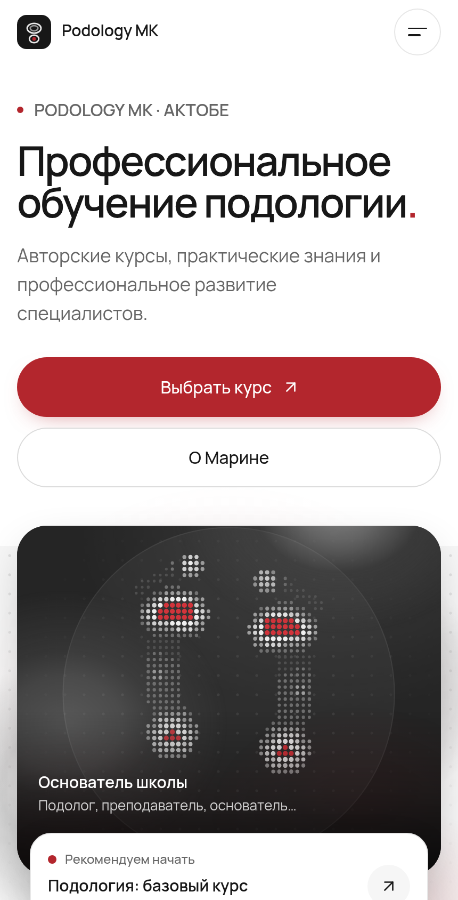
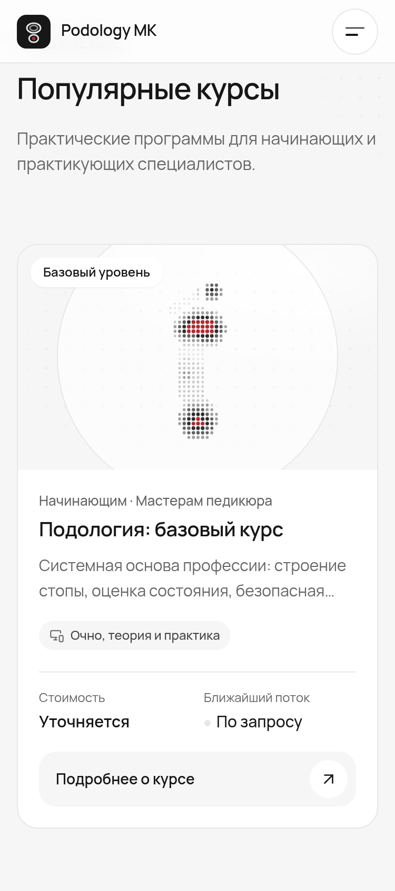
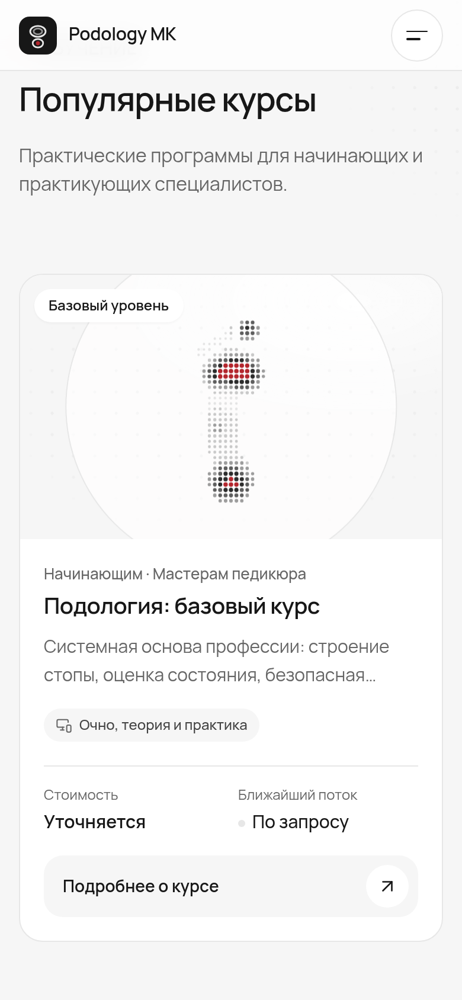
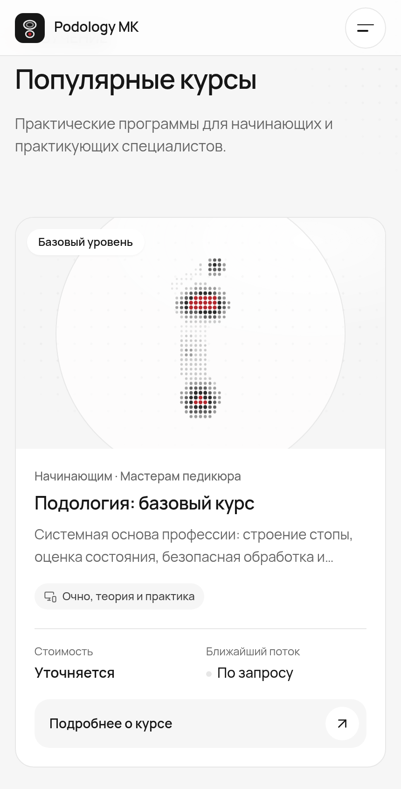

# Podology MK mobile motion — first iteration

The homepage keeps its white, graphite and red identity, existing composition and business content. Slow liquid-light gradients breathe around the hero illustration. The headline enters line by line, with a small horizontal expansion that suggests tracking without reflow. Heading and decorative scroll effects enhance native scrolling where CSS view timelines are supported.

The spotlight, first featured course and final CTA have a masked 1px traveling light. Only the first featured illustration drifts (3px); card text and tap targets stay stationary. Course links have immediate pointer feedback and a soft settling curve. A named React ViewTransition connects course illustrations to detail pages when the browser and route commit support it; ordinary navigation remains the fallback.

## Mobile previews

Captured from the production static export at DPR 2, with touch and mobile viewport emulation. Images are review artifacts outside `public/` and are never downloaded by visitors.

| Chromium | 375px | 390px | 430px |
| --- | --- | --- | --- |
| Hero |  |  |  |
| Courses |  |  |  |

[390px motion recording](previews/mobile-motion.webm) · [Final CTA](previews/chromium-cta-390.png)

WebKit previews: [375px](previews/webkit-hero-375.png), [390px](previews/webkit-hero-390.png), [430px](previews/webkit-hero-430.png), [courses](previews/webkit-courses-390.png), [CTA](previews/webkit-cta-390.png).

## Motion and accessibility controls

- Gradient textures are static; loops animate transforms and opacity. No new filters, canvas, WebGL, or animation dependencies.
- Each ambient region opts in through IntersectionObserver. It pauses outside the viewport, in hidden tabs, during reduced motion, and while a course is pressed or focused. Unsupported observers leave static decoration.
- Reduced motion disables the new entrances, scroll motion, loops and shared-element animations. CSS view timelines and masks have static fallbacks. The headline is visible from its first frame, including without JavaScript.
- No wheel/touchmove scroll handlers, canceled navigation, fixed-height content, or changes to form delivery.

## Verification

`npm run check`, the root static export, and the `/mk01` static export all pass. Chromium and WebKit also pass [subpath navigation checks](static-path.json) with no HTTP errors or uncaught browser errors. Chromium canceled speculative fetches during navigation; those expected cancellations are recorded separately.

See [browser results](previews/verification-chromium-webkit.json), [content preservation](content-preservation.json), [Lighthouse samples](lighthouse.json), and [frame/main-thread samples](profile.json).

Chromium 154 and Playwright WebKit 26.5 pass at **375, 390 and 430 × 844px**. The checks cover overflow, actual ambient movement, offscreen freezing, initial and live reduced motion, focus pause, touch navigation, pointer press/cancellation, menu controls, enrollment form visibility and validation, and JavaScript-free content. Axe found **zero WCAG A/AA violations** on the homepage in either engine. A 1280px Chromium smoke check also confirmed no horizontal overflow.

All text, link destinations, form fields, SEO metadata and JSON-LD match baseline commit `6c0934b` across **18 exported HTML documents**. This includes branch/contact information and payment methods. The API and business data files are untouched. No real enquiries were submitted.

The supported Next 16.4 / React 19.3 route transition was instrumented in Chromium: `document.startViewTransition` started and its `ready` promise resolved during featured-course navigation. Browsers that cannot animate this transition still navigate normally.

## Performance results

Lighthouse 13.6, Chromium 154, mobile 412 × 823px, simulated Slow 4G and 4× CPU slowdown; three alternating cold-cache runs per export, served without compression by the same Python static server. Medians:

| Metric | Baseline | Motion iteration |
| --- | ---: | ---: |
| Performance score | 61 | 58 |
| Accessibility score | 100 | 100 |
| First / largest contentful paint | 4.655s | 4.656s |
| Cumulative layout shift | 0 | 0 |
| Total blocking time | 418ms | 494ms |
| Speed index | 4.827s | 5.100s |

Performance scores varied from 58–64 on baseline and 46–62 on this iteration. LCP and layout stability are preserved in these samples; startup blocking time and visual completion are slightly higher. These are local lab results, not field Core Web Vitals or a claim that the existing load time meets the LCP target. INP needs field interaction data. Animations make no recurring network requests and add no animation library; total exported JavaScript grows by about 35.7KB uncompressed across all route chunks, and CSS by about 4.6KB.

A separate, unthrottled 390 × 844px DPR 2 Chromium profile sampled each scene for five seconds, with no concurrent build or browser test:

| Scene | Baseline p95 frame | Motion p95 frame | Motion frames >33.4ms | Motion main-thread task time / 5s | Layouts |
| --- | ---: | ---: | ---: | ---: | ---: |
| Hero | 16.7ms | 16.7ms | 0 / 300 | 343ms | 0 |
| Featured courses | 16.8ms | 16.8ms | 4 / 280 | 415ms | 0 |
| All ambient regions offscreen | 16.8ms | 16.8ms | 0 / 300 | 137ms | 0 |

The requestAnimationFrame probe itself adds work. Main-thread task time corresponds to roughly 6.9% of the sampled interval in the hero, 8.3% at the featured cards and 2.7% with ambient regions offscreen; it is a browser workload proxy, not whole-device CPU consumption. No animation-triggered layout occurred. Hardware GPU utilization, thermal behavior, battery drain, and real-phone smoothness are unavailable in this headless environment and remain device-validation items. The four longer featured frames are retained in the evidence rather than excluded.

## Reproduce

Use Node 22+ and a production build. Keep audit tools outside the application so they do not enter its dependency graph:

```bash
npm ci
npm run check
npm run build:pages
npm install --prefix /tmp/podology-motion-tools playwright@1.62.1 @axe-core/playwright@4.14.0 lighthouse@13.6.0
/tmp/podology-motion-tools/node_modules/.bin/playwright install --with-deps chromium webkit
python3 -m http.server 4174 --directory out
```

In another terminal:

```bash
export MOTION_TOOLS_DIR=/tmp/podology-motion-tools
export CHROME_PATH=/path/to/chromium
MOTION_ENGINES=chromium,webkit node scripts/verify-motion.mjs
node scripts/record-motion.mjs
```

To compare with baseline, build `6c0934b` in a separate checkout and serve its export at port 4173. Stop other builds and browser tasks before measuring:

```bash
python3 scripts/verify-preservation.py /path/to/baseline/out out
node scripts/audit-motion.mjs
node scripts/profile-motion.mjs
```

`BASELINE_URL`, `MOTION_URL`, and output paths can be overridden; the audit script saves full raw Lighthouse reports under `/tmp/podology-motion-audits` by default. Finally, check the GitHub Pages subpath:

```bash
NEXT_PUBLIC_BASE_PATH=/mk01 npm run build:pages
# Serve a directory containing mk01/ -> the generated out/ directory.
MOTION_URL=http://localhost:4175/mk01 MOTION_ENGINES=chromium,webkit node scripts/verify-motion.mjs
```
